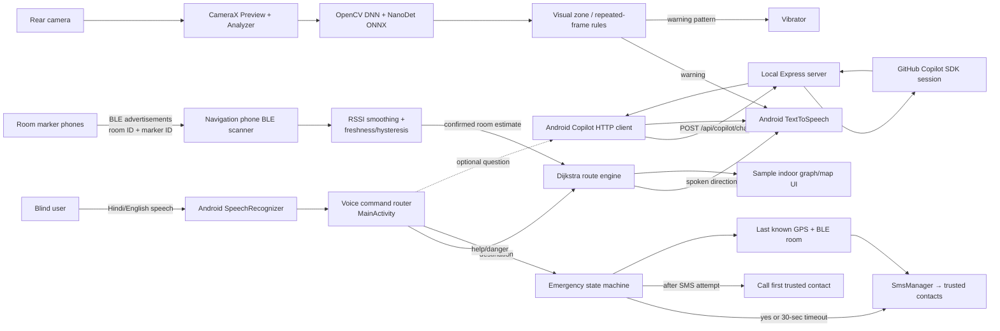
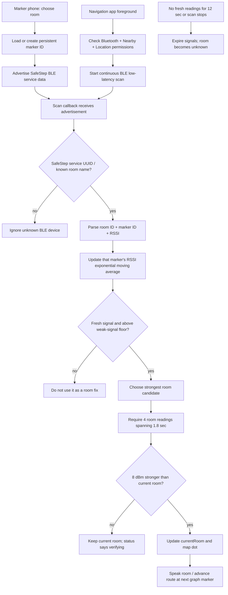
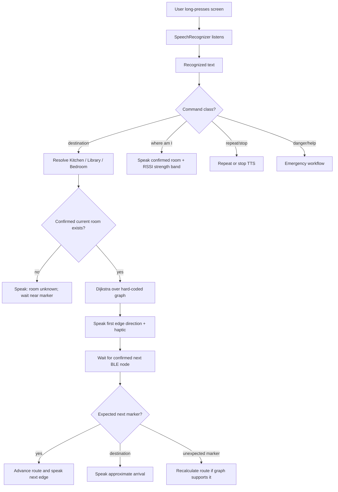
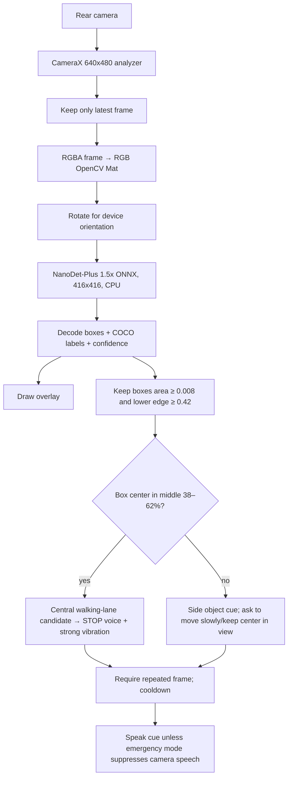
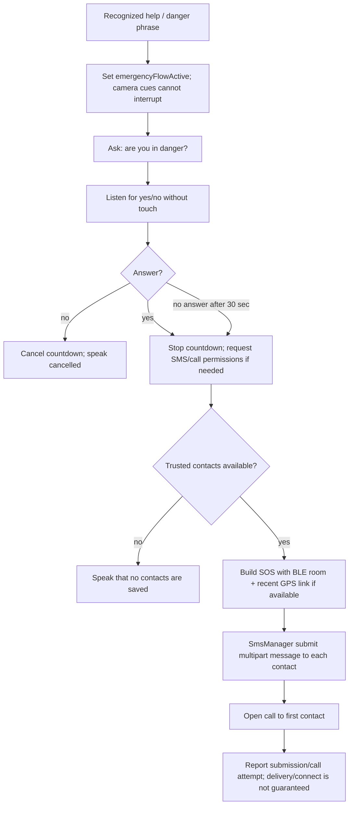

# SafeStep Indoor Navigation — Technical Analysis & System Design

> **Scope:** This document describes the current native Android POC found in `android/`. The root-level HTML/JavaScript files are a legacy browser prototype and are not the Android app's runtime path. Read this as an implementation and hackathon-demo design, not a safety certification.

## 1. Product summary

SafeStep is a voice-first Android proof of concept for indoor room-to-room guidance. A user speaks a destination, a navigation phone scans for SafeStep BLE room markers, and the app uses a locally defined floor graph to produce Hindi/English guidance. Camera frames are analyzed locally by OpenCV DNN + NanoDet, with spoken and vibration cues. A user-initiated emergency flow can submit SMS messages and call a saved contact. An optional GitHub Copilot SDK endpoint answers general questions about the demo.

The app does **not** provide surveyed indoor coordinates, SLAM, verified turn/arrival detection, calibrated obstacle distance, or a certified mobility aid. BLE identifies a nearby marker approximately; the graph is sample data; the detector is a general COCO object model.

## 2. Technology stack by feature

| Feature / layer | Technology currently used | What it does |
|---|---|---|
| Mobile app | Native Android, Kotlin, AndroidX AppCompat/Activity/Core | Main app lifecycle, accessible controls, permissions, local state, dialogs and UI |
| Build | Gradle wrapper 8.11.1, Android Gradle Plugin 8.9.2, Kotlin 2.0.21, Java/JVM 17, compile/target SDK 35, min SDK 26 | Builds and packages the Android app |
| Camera preview | CameraX Camera2 + Lifecycle + View | Rear camera preview and 640×480 image-analysis stream bound to the Activity lifecycle |
| Object recognition | OpenCV 4.12.0 DNN, bundled NanoDet-Plus 1.5x ONNX, CPU backend | On-device COCO object detection; no vision API key or cloud inference is needed |
| Camera cue rules | Kotlin rules in `MainActivity` | Filters lower-frame boxes, splits center/left/right zones, requires repeated frames, triggers TTS and vibration |
| BLE beacon transmit | Android `BluetoothLeAdvertiser` | Marker phone broadcasts SafeStep service data: protocol version, room ID, persistent per-room marker ID |
| BLE scan / room estimate | Android `BluetoothLeScanner`, RSSI EMA + time/sample hysteresis | Navigation phone scans advertisements and estimates the nearest stable room marker |
| Voice input | Android `SpeechRecognizer`, `RecognizerIntent`, `hi-IN` | Recognizes Hindi commands using the phone's configured speech service; network-capable mode is requested |
| Speech output | Android `TextToSpeech`, Hindi locale `hi-IN` | Reads navigation, safety, status and Copilot response text aloud |
| Haptics | Android `Vibrator` / `VibratorManager` | Short vibration patterns for prompts and warnings |
| Movement hint | Android `TYPE_STEP_DETECTOR` sensor | Estimates walking vs stationary from phone step events; it does not track coordinates |
| Route planning | Kotlin graph + Dijkstra shortest path | Selects a path over the sample Entrance/Junction/Kitchen/Library/Bedroom graph |
| Emergency contacts | Android `SharedPreferences` + JSON | Stores trusted names/numbers locally on the device |
| Emergency SMS/call | Android `SmsManager`, multipart SMS, `ACTION_CALL`/`ACTION_DIAL`, `LocationManager` last-known fix | Attempts an SMS to every saved contact and call to the first contact after confirmation/timeout |
| Optional assistant | Node.js 20+, Express 5, `@github/copilot-sdk` 1.0.19 | Local development server relays optional text prompts to a GitHub Copilot SDK session |
| Android → assistant API | `HttpURLConnection`, JSON over HTTP | Posts a question to `/api/copilot/chat`; the app speaks the returned answer |
| Local storage | Android private preferences/files | Trusted contacts, Copilot server URL, per-room marker IDs and the bundled model copy |

### Important Copilot boundary

GitHub Copilot is **not** the route planner, speech recognizer, TTS engine, BLE localizer or obstacle detector. The Android app computes routes locally with Dijkstra, Android speech APIs handle voice, OpenCV runs the detector, and BLE callbacks estimate the room. Copilot is an optional question-answering assistant. Its server prompt explicitly tells it not to invent location or control safety-critical routes.

## 3. High-level design (HLD)



**Deployment shape:** The app's safety-critical/demo paths are on-device. The Copilot sidecar runs on a developer computer and is reached over USB port reverse, emulator host routing, or a same-Wi-Fi LAN URL. There is no production cloud backend or central database in this POC.

## 4. Low-level design (LLD)

### Main components

| Component | Responsibility | Key implementation details |
|---|---|---|
| `MainActivity` | App coordinator, lifecycle, permission requests, UI, command router, route state, BLE state, emergency flow | Currently combines many responsibilities in one Activity; this is acceptable for a POC but should be split before production |
| `NanoDetDetector` | Load ONNX and infer objects from RGB OpenCV `Mat` frames | Initializes OpenCV locally, copies model from assets, 416×416 letterbox, ImageNet-style normalization, DNN CPU backend, decode 3 output levels, class-wise NMS |
| `DetectorOverlayView` | Draw boxes/labels over camera preview | Uses normalized detection box coordinates mapped to preview dimensions |
| `IndoorMapView` | Draw schematic graph, route and current room node | The floor drawing is fixed sample geometry; current room and route overlays change from app state |
| `SpeechRecognizer` listener | Accept recognized results/errors/partials | Push-to-talk uses a long press anywhere on the screen; SOS confirmation opens voice listening without requiring another hold |
| `TextToSpeech` listener | Sequence prompts, avoid speaking while user is talking, resume listening | Hindi locale; spoken instructions and route cues are queued/managed in the Activity |
| BLE scan callback | Parse recognized SafeStep service advertisements and update signal cache | Uses service UUID `8d53dc1d-1db7-4cd3-868b-8a527460aa84`; keeps a record per marker identity |
| BLE advertiser callback | Start/stop a room marker and expose status | Advertises room ID and a persisted random marker ID; retries without Bluetooth local name if advertisement payload is too large |
| Express server (`server.mjs`) | Create/reuse Copilot SDK client/session and handle chat requests | Prompt limited to 1–1500 chars; SDK model defaults to `gpt-5`; binds to `0.0.0.0` for local-network demo |

### Core data models

```text
RoomSignal { room, rssi, seenAt }
Edge       { to, meters, instructionHi }
RouteNode  { key, edges[] }
TrustedMember { name, phone }
Detection  { label, confidence, normalized box, center, area }
```

`RoomSignal` is stored by a marker key rather than by room name alone, so two phones advertising the same room can be tracked independently. Contact list and per-room marker IDs are stored in app-private preferences. The current route graph and map-node coordinates are hard-coded in Kotlin; they are not read from a user-provided house plan.

## 5. Key workflows

### 5.1 BLE room detection and live map update



Current heuristics in code: an RSSI reading weaker than `-88 dBm` is not used as a room fix; candidate room needs at least 4 readings spanning 1.8 seconds, sampled at least 400 ms apart; room hand-off needs an 8 dBm advantage if the old room marker is still fresh; readings expire after 12 seconds. These thresholds are noise filters, **not calibrated distance estimates**. RSSI in dBm is received signal power, not metres.

**Marker setup:** each marker phone must run SafeStep, choose its map room, and remain in the foreground. A phone's ordinary Bluetooth pairing/name alone does not guarantee a BLE advertisement with the room name. SafeStep's marker mode carries the room identity in its own service data. No pairing or active BLE connection is needed; this is connectionless advertising/scanning.

### 5.2 Spoken navigation



The current sample graph has Entrance → Junction, Junction → Kitchen/Library/Bedroom branches, and each room → Junction return edges, with sample edge lengths and Hindi phrases. It currently has **no Junction → Entrance edge**, so routes back to Entrance are not complete. Dijkstra computes a shortest path from the confirmed current room. BLE room transition is used as a graph checkpoint. The app does not know the user's heading, prove that a right turn was made, or measure walking distance. Therefore “go straight/right” is a pre-authored edge instruction associated with a marker-to-marker link, not a turn detected by sensors.

### 5.3 Camera and obstacle cue



Inference is throttled to at most about 4 frames/sec (250 ms spacing), runs on a single camera executor, and uses CameraX `STRATEGY_KEEP_ONLY_LATEST`. OpenCV inference is CPU-based. The classifier sees only the 80 COCO classes and has no depth sensor or calibrated camera-distance model. In the current rule code, a relevant center-lane detection causes a stop cue; side-only objects cause a caution/slow-straight phrase. Box area is a visual heuristic, not a distance. A missing detection does not mean the path is clear.

### 5.4 Emergency / trusted-contact flow



Trusted member data is device-local. SMS submission needs SEND_SMS, a usable SIM and mobile network; SMS method success does not confirm delivery. The GPS link is Android's last-known fix if no older than 10 minutes; BLE supplies only an approximate room. `ACTION_CALL` may fail or be unanswered. The app calls only the first saved member. Emergency execution can be activated by voice; the manual emergency card remains available as another entry point.

## 6. Permissions and lifecycle

| Android permission / capability | Used for |
|---|---|
| `CAMERA` | Rear camera and OpenCV inference |
| `RECORD_AUDIO` | Speech recognition |
| `BLUETOOTH_SCAN` / `BLUETOOTH_ADVERTISE` / `BLUETOOTH_CONNECT` (Android 12+) | BLE scanner, marker advertiser and device data access |
| `ACCESS_FINE_LOCATION` / `ACCESS_COARSE_LOCATION` | Room-proximity/location behavior and last-known location; older Android also needs Location services enabled for BLE scan |
| `SEND_SMS` | Direct emergency SMS submission |
| `CALL_PHONE` | Direct call intent to primary trusted contact |
| `ACTIVITY_RECOGNITION` | Step-sensor activity hint on supported Android versions |
| `VIBRATE` | Guidance and alert patterns |
| `INTERNET` | System speech service as configured, Copilot HTTP, and development connectivity |

BLE scan and advertising stop when the Activity leaves the foreground, then resume when it returns. This keeps behavior scoped to the open demo app; there is no foreground service or background navigation mode. Android 11 and earlier require system Location to be enabled for BLE scanning. On Android 12+, accept Nearby devices and Location prompts. Android Speech Services and Hindi TTS voice data must be available for Hindi input/output.

## 7. Copilot development and runtime flow

```mermaid
sequenceDiagram
    participant User
    participant App as Android SafeStep
    participant Server as Express server (PC)
    participant SDK as GitHub Copilot SDK / CLI
    User->>App: Ask Copilot a question
    App->>Server: POST /api/copilot/chat {message}
    Server->>Server: Validate 1–1500 character prompt
    Server->>SDK: Reuse/create Copilot session; send guarded prompt
    SDK-->>Server: Assistant response
    Server-->>App: JSON reply
    App->>User: Show and speak reply with Android TTS
```

The server must be running on the development computer and signed into Copilot there. USB demo uses `adb reverse tcp:4173 tcp:4173`; emulator uses `10.0.2.2:4173`; a phone over Wi-Fi uses the computer LAN IP. The manifest permits cleartext traffic and the Express server binds to all interfaces with no app-level authentication, so this is for a trusted local demo only. Do not expose it to the public internet as configured.

## 8. Current boundaries and work needed for a real deployment

1. **Map authoring:** replace hard-coded room nodes, drawing positions, edges, distances and voice directions with a surveyed floor-plan/map editor or imported map. Validate every directed edge and accessible route.
2. **Indoor localization:** RSSI cannot reliably determine exact room or distance. Calibrate per venue/device, use multiple fixed beacons and robust filtering, or investigate UWB / another validated indoor-positioning system. A room label can still be wrong across walls.
3. **Pedestrian tracking:** phone step sensor estimates motion only. Add validated heading/orientation and turn tracking before claiming turn confirmation; phone placement changes sensor results.
4. **Obstacle safety:** NanoDet is a general COCO object detector. Add depth/ranging hardware or validated depth estimation, train/evaluate on household hazards, and conduct accessibility testing. Current bounding boxes are not collision-distance measurements.
5. **Voice reliability:** Android recognition depends on the installed speech service, network and language model. Add explicit ready/error recovery and evaluate Hindi/Hinglish command accuracy across real phones and environments.
6. **Emergency delivery assurance:** track SMS sent/delivery callbacks, permission denial, SIM/network failures, retries and contact consent. Add an independently tested backend/SMS provider only if product requirements need delivery acknowledgments.
7. **Copilot service security:** add TLS, authentication, rate limits and deployment secrets before any shared/public service. Keep its output away from control of safety-critical actions.
8. **App architecture:** split the large `MainActivity` into view/activity, voice, BLE, camera, route, and emergency services/repositories; expose observable state to UI and isolate testable algorithms.
9. **Validation:** test BLE hand-offs with different phone models, rooms, wall materials, orientation, pocket/bag placement and interference. Add unit tests for graph routing, BLE state transitions, SOS state machine and detector decision rules, then perform supervised user testing.

## 9. Source map

- Android screen, voice, routes, BLE, emergency and Copilot client: `android/app/src/main/java/com/safestep/mobile/MainActivity.kt`
- OpenCV DNN/NanoDet preprocessing and output decoder: `android/app/src/main/java/com/safestep/mobile/NanoDetDetector.kt`
- Bundled model: `android/app/src/main/assets/object_detection_nanodet_2022nov.onnx`
- Model attribution: `android/app/src/main/assets/MODEL-NOTICE.txt`
- Android permissions and launch activity: `android/app/src/main/AndroidManifest.xml`
- Android dependencies and SDK levels: `android/app/build.gradle.kts`
- Copilot SDK server: `server.mjs`; Node dependencies: `package.json`
- Demo steps and prototype boundaries: `android/README.md`

